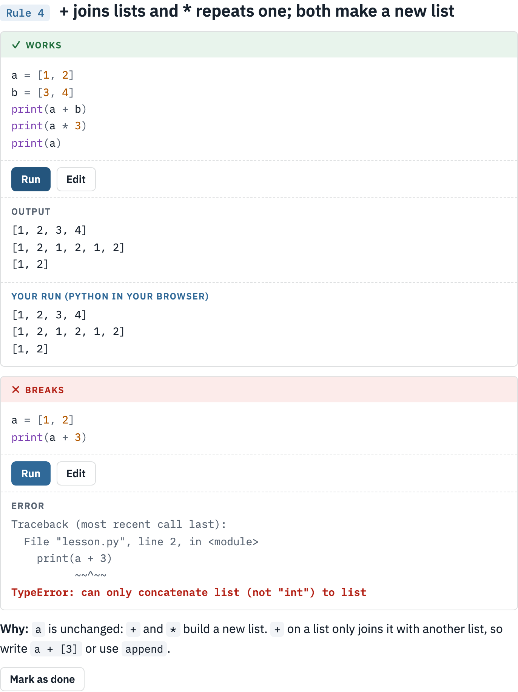
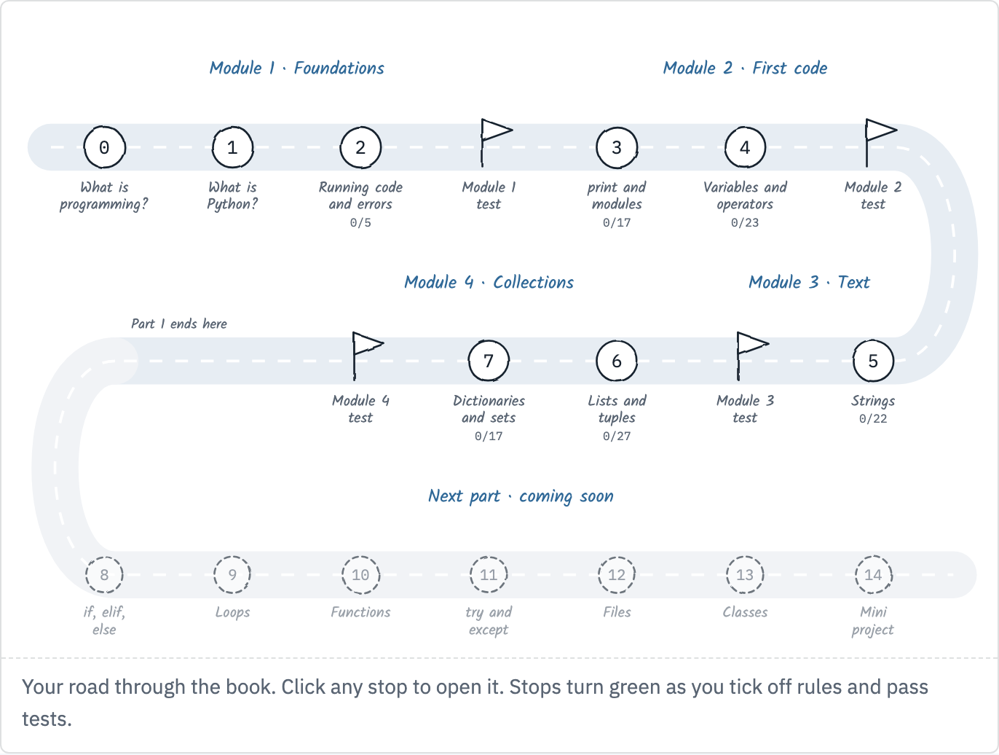
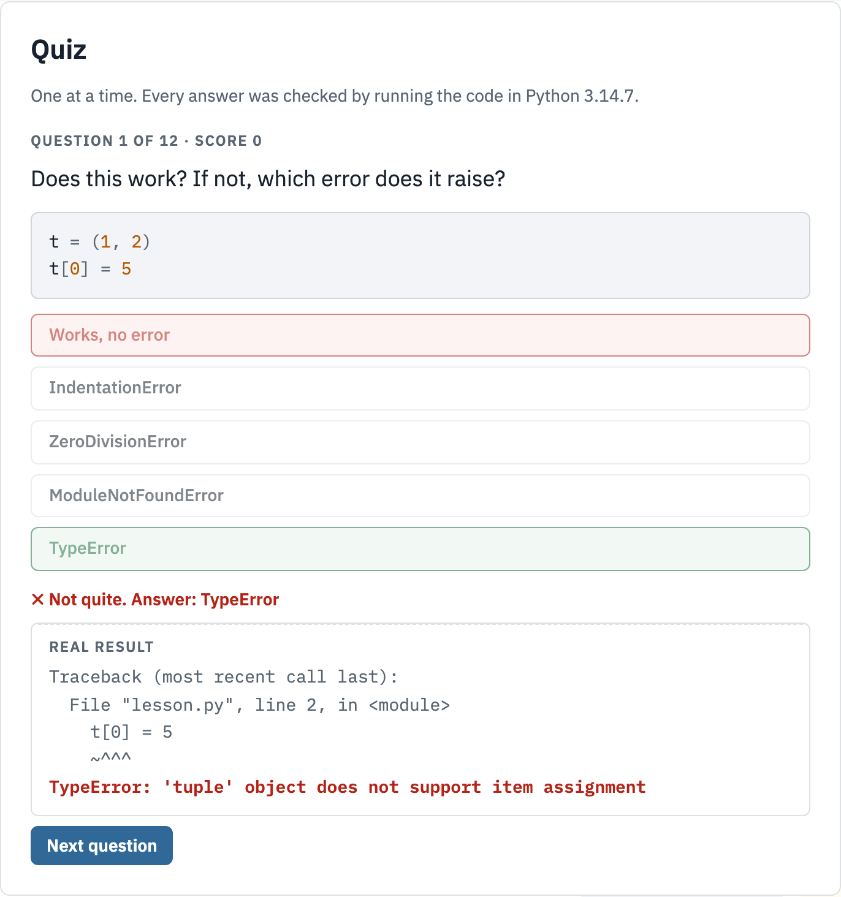
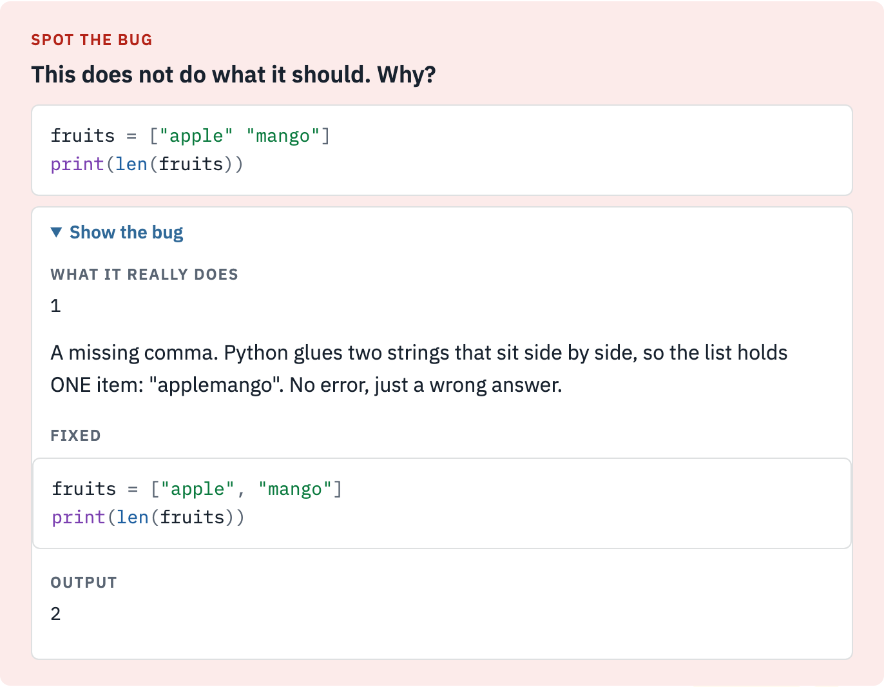

# Python From Zero - an interactive Python book

> A hands-on, beginner-first Python course in one HTML file. It starts at "what is programming" and teaches every rule the same way: code that **works**, code that **breaks** with the **exact error Python prints**, and **why**. Every example has a **Run** button (real Python 3.14 running in your browser), and every output on the page was produced by actually running the code in Python 3.14.7 when the book was built.
>
> *Part 1 (chapters 0 to 7) is done. Part 2 (if, loops, functions, errors, files, classes, a mini project) comes next, in the same format.*

<p align="center">
  
  <br/>
  <em>From Chapter 6 - one rule: the working code and its output, your own run in the browser, the breaking code with the real error, and why.</em>
</p>

> **Private notes.** This repo also holds my own chapter notes, practice files and revision handbook that the book was built from.

---

## The roadmap

Part 1 is four modules. Read in order; each chapter ends with a quiz and each module ends with a mixed test.

<p align="center">
  
  <br/>
  <em>The home page roadmap. Each stop opens its chapter and turns green as you tick off rules and pass tests; a pin marks where you stopped.</em>
</p>

| Module | Chapter | Book pages | Rules | Exercises | Quiz | Break it |
|---|---|---:|---:|---:|---:|---:|
| **1 · Foundations** | 0 - What is programming? | 2 | - | 4 | 5 | - |
| | 1 - What is Python? | 2 | - | 5 | 5 | - |
| | 2 - Running Python, and reading errors | 3 | 5 | 5 | 5 | 2 |
| | *Module 1 test* | | | | 15 mixed | |
| **2 · First code** | 3 - print(), comments and modules | 7 | 17 | 10 | 10 | 2 |
| | 4 - Variables, types and operators | 9 | 23 | 20 | 12 | 3 |
| | *Module 2 test* | | | | 20 mixed | |
| **3 · Text** | 5 - Strings | 9 | 22 | 16 | 12 | 3 |
| | *Module 3 test* | | | | 15 mixed | |
| **4 · Collections** | 6 - Lists and tuples | 10 | 27 | 18 | 12 | 3 |
| | 7 - Dictionaries and sets | 7 | 17 | 16 | 11 | 3 |
| | *Module 4 test* | | | | 25 mixed | |
| | **Part 1 cheat sheet** · **Part 1 revision sheet** | 2 | | | | |
| **Total** | 8 chapters | **67** | **111** | **94** | **72** + 4 tests | **16** |

---

## How to read

### 1 · In your browser (recommended)
The **Run** buttons need the page served over http, so start a tiny local server:

```bash
git clone https://github.com/chethanbhatbs/python-from-zero.git
cd python-from-zero/python-course
python3 -m http.server 8765
# open http://127.0.0.1:8765/python-course.html
```

The first **Run** downloads Python into the browser (Pyodide, about 10 MB). After that it is instant.

### 2 · Just reading
Double-click `python-course/python-course.html`. Everything reads fine; only the Run buttons need the server above.

### 3 · Mobile
The page re-flows for phone screens: the side menu moves to the top, tables and diagrams scroll inside their own boxes.

---

## What every chapter has

| Part | What it does |
|---|---|
| **Rules** | One idea each: ✓ Works (real output) · ✗ Breaks (real error) · Why. Numbered from 1 inside each topic. |
| **Run and Edit** | Every example runs in the browser. Edit it, break it, run again. `Cmd + Enter` runs too. |
| **Traps** | Code that runs without an error but does something you did not mean. |
| **Brain breaks** | At the end of every page: a 5-second puzzle, spot the bug, a sourced fact, or a joke. They only use what has been taught so far. |
| **Key takeaways** | 4 to 6 short points before the exercises. |
| **Exercises** | *Predict* (type the output, press **Check** for ✓ or ✗), *Write* (press **Run my code**), *Think*. |
| **Break it** | Start from working code and make it raise a named error. The page checks you hit that exact error. |
| **Chapter quiz** | One question at a time, a score at the end, retry only the ones you missed. |

<p align="center">
  
  &nbsp;
  
  <br/>
  <em>Left: a Chapter 6 quiz question. Right: a "spot the bug" break with the real error and the fixed code.</em>
</p>

Progress (ticked rules, best quiz scores, the last page you read) is saved in your browser only.

---

## What's in each part

**Module 1 - Foundations**
What a program is (exact steps, done in order), machine code and why languages exist, syntax. Who made Python (Guido van Rossum, from 1989), why it is named after Monty Python, compiled vs interpreted (C, Go, Rust vs Python vs Java), with a real C compile and Python's hidden bytecode step shown by running them. Running a file, the `>>>` prompt, the two passes Python makes over a file, and how to read a traceback.

**Module 2 - First code**
`print()` with `sep` and `end`, quotes, comments, triple quotes, `import` and `from ... import`, pip, and the trap of naming your file after a module. Variables and the naming rules, types and `type()`, every operator, `and`/`or`/`not`, `+=` and swapping, conversions and `bool()`, f-strings with `:.2f`, `.format()` and `%`, `input()`.

**Module 3 - Text**
Indexing, negative indexes, slices and steps, why strings never change, and every string method one rule at a time: case, `strip`, `replace`, `find` vs `index`, `count`, `startswith`/`endswith`, the is-methods, `center`/`zfill`, `split` and `join`, `in`, escape characters, `repr()`.

**Module 4 - Collections**
Lists: positions and errors, adding and removing, `sort()` vs `sorted()`, searching and combining, slices, and the copy trap (`b = a` vs `.copy()`, shown with a shared Google Doc). Tuples and their two methods, unpacking. Dictionaries: reading safely with `get()`, adding, `pop`, `update`, key rules. Sets: no duplicates, no positions, and `|` `&` `-` `^`.

**Part 1 cheat sheet** - 40 most-used lines with their real results, including the errors you will meet.

**Part 1 revision sheet** - all 75 topics: a one-line definition and one small example with its real output.

---

## How it is built

```bash
cd python-course
python3 build.py   # runs every example, writes python-course.html
```

`build.py` runs **every** example, quiz question, break-it challenge, cheat-sheet line and revision example in Python, and writes the real output into the page. The build **stops** if an example that should work fails, or an example that should break raises a different error than the text says, so the page cannot claim something Python does not do.

- Course content and engine: `python-course/build.py`
- Quizzes, break-it challenges, takeaways, cheat sheet, revision sheet, brain breaks: `python-course/quizbank.py`
- In-browser Python: [Pyodide](https://pyodide.org) 314.0.7 (Python 3.14.2), loaded from jsDelivr on first Run

---

## Design

Light, book-like pages with page numbers, Python blue and yellow, IBM Plex Sans and Plex Mono, and hand-drawn diagrams in an Excalidraw style (Kalam font, rough strokes). The Python logo is a faint watermark on each page.

## Notes

- Facts are sourced: the Python FAQ and docs, CERN, MDN, Oracle, the Rust Book, go.dev, the Computer History Museum and the Science Museum, linked in the book.
- The photo of Guido van Rossum is by Daniel Stroud, [CC BY-SA 4.0](https://creativecommons.org/licenses/by-sa/4.0), via [Wikimedia Commons](https://commons.wikimedia.org/wiki/File:Guido-portrait-2014-drc.jpg), and is credited in the book.
- My own study material lives alongside the book: `Chapter1`-`Chapter5` and their `-PS` problem sets, `Practice/`, and `Python_Revision.md` (an Obsidian note).
